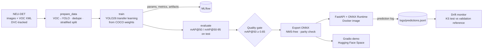
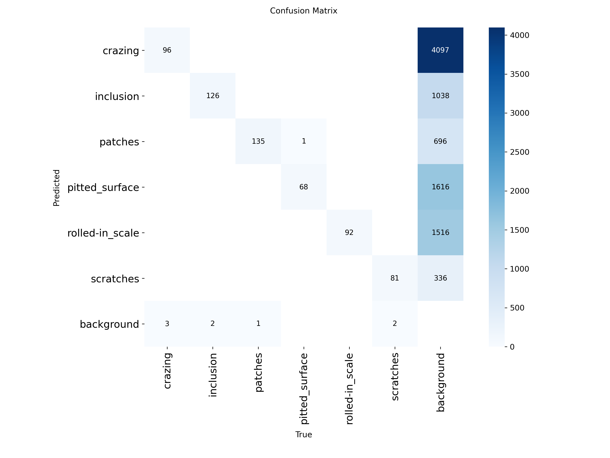
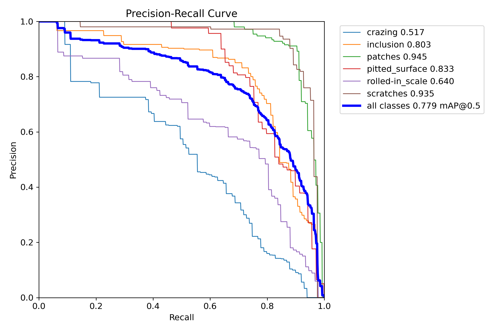
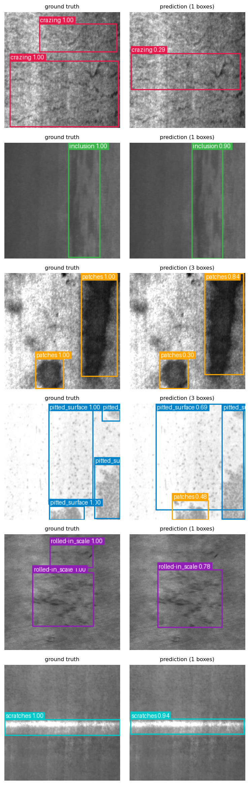

# Steel Surface Defect Detection: YOLO26 + MLOps

End-to-end computer vision project: fine-tune YOLO26 to detect and localise 6 types of hot-rolled steel
surface defects (NEU-DET), then ship it the way a production team would: reproducible pipeline, experiment
tracking, tested code, containerised API, CI/CD, and drift monitoring.

> **Live demo:** https://huggingface.co/spaces/deplearning-s/steel-defect-demo &nbsp;|&nbsp; **API image:** `ghcr.io/devinasawitrii/defect-detection-mlops/defect-api`

## Why this project

Manual visual inspection on a steel line is slow and inconsistent. A detector that says *what* defect is present
and *where* lets the line react early (and handles strips with several defects). The model is intentionally the
smaller half of this repo; the point is the full lifecycle around it.

## Architecture

## Results

Evaluated once on the held-out test split (270 images, 607 boxes). Model: YOLO26n, fine-tuned from COCO weights.

| Metric (held-out test set) | Value |
|---|---|
| mAP@50 (PyTorch) | **0.779** |

Per-class AP@50:

| Class | AP@50 |
|---|---|
| crazing | 0.517 |
| inclusion | 0.803 |
| patches | 0.945 |
| pitted surface | 0.833 |
| rolled-in scale | 0.640 |
| scratches | 0.935 |

Crazing and rolled-in scale are the weakest classes (diffuse boundaries), which matches published YOLO baselines on this dataset.

**Confusion matrix**



**PR Curve**



**Predictions from the exported ONNX model**



## What's inside

| Area | Tooling | Where |
|---|---|---|
| Data versioning & pipeline | pipeline stages defined in dvc.yaml | `dvc.yaml`, `params.yaml` |
| Data hygiene | Pascal VOC → YOLO conversion, box clipping, MD5 de-duplication, stratified split (no leakage) | `src/prepare_data.py` |
| Modelling | Ultralytics YOLO26, COCO-pretrained transfer learning, AdamW, early stopping | `src/train.py` |
| Experiment tracking | MLflow (params, per-epoch metrics, checkpoint artifact) | `make mlflow-ui` |
| Evaluation | mAP@50, mAP@50-95, per-class AP, confusion matrix, PR curves | `src/evaluate.py` |
| Serving | NMS-free ONNX export with parity check, ONNX Runtime, FastAPI (`/predict`, `/predict/image`, `/health`, `/stats`) | `src/export_onnx.py`, `serving/` |
| Packaging | Slim Docker image (no PyTorch / Ultralytics), non-root user, healthcheck | `Dockerfile` |
| CI | Ruff + pytest on synthetic data (trains a tiny YOLO26, no downloads) + model quality gate | `.github/workflows/ci.yml` |
| CD | Build, container smoke test, push to GHCR, deploy demo to Hugging Face Spaces | `.github/workflows/cd.yml` |
| Monitoring | Every prediction logged; KS-test drift on brightness, contrast, detections/image, top confidence | `src/monitor.py`, `src/simulate_traffic.py` |


## Design decisions & trade-offs

- **Detection** Real lines have several defects per strip and care where they are.
  YOLO is still a CNN under the hood, and it is fine-tuned from COCO weights (transfer learning).
- **NMS-free head, used consistently.** YOLO26 can export a head whose outputs are already final detections.
  Training-time model selection, evaluation, parity checks and export all use that same head (`nms=False`), so the
  reported mAP describes the model that is actually deployed.
- **ONNX Runtime for serving.** The API image doesn't ship PyTorch or Ultralytics, so it stays small. The
  export step fails the build if ONNX and PyTorch outputs disagree.
- **Train/serve preprocessing parity.** The serving letterbox reimplements Ultralytics' (OpenCV bilinear, grey 114
  padding, same rounding) and is tested pixel-for-pixel. An earlier PIL-based resize differed enough to change
  detection counts.
- **De-duplication before splitting.** Mirrors of this dataset contain repeated files; leaving them in inflates test scores.
- **Drift on cheap statistics.** Brightness, contrast, detections per image and top confidence need no labels, so
  they work in production where ground truth arrives late (if at all).

## Drift monitoring

Every prediction is logged (brightness, contrast, detections per image, top confidence). The monitor compares recent traffic against statistics from the validation set with a Kolmogorov-Smirnov test (alpha = 0.01), so it needs no labels.

`make drift-demo` simulates this: 200 normal images, then 200 images with a simulated lighting drop and sensor noise.

| Feature | Reference mean | Normal traffic | Drifted traffic |
|---|---|---|---|
| Brightness | 0.497 | 0.507 (ok) | 0.277 (**drift**) |
| Contrast | 0.105 | 0.096 (ok) | 0.090 (**drift**) |
| Detections / image | 2.12 | 2.13 (ok) | 0.10 (**drift**) |
| Top confidence | 0.672 | 0.700 (ok) | 0.033 (**drift**) |
| **Status** | | `ok` | `drift` |

The drift here is simulated, not real plant data. The command exits non-zero on drift, so it can gate a scheduled job or trigger retraining.

## Limitations

- NEU-DET images are clean, uniform, 200×200 grayscale. Real lines have lighting changes, motion blur and new
  defect types; expect a domain gap and plan for fine-tuning on plant data.
- The gate threshold (mAP@50 ≥ 0.65) is a starting point; set it from your own baseline.
- Automate retraining when the drift monitor fires; promote models through the MLflow Model Registry.

## Project layout
```
├── src/                  data prep, training, evaluation, ONNX export, visualisation, monitoring
├── serving/              ONNX detector, FastAPI app, prediction logging
├── app.py                Gradio demo (Hugging Face Space entrypoint)
├── tests/                pytest suite on synthetic data
├── notebooks/            training notebook
├── deploy/               Hugging Face Space config
├── scripts/              deploy_hf.py (publishes the demo to Hugging Face Spaces)
├── models/               exported ONNX model + class names
├── metrics/              eval.json, export.json (test metrics)
├── reports/              confusion matrix, PR curves, predictions grid, drift reference stats
├── logs/                 prediction log used by the drift monitor
├── .github/workflows/    CI (ci.yml) and CD (cd.yml)
├── dvc.yaml              pipeline stages (prepare, train, evaluate, export)
├── params.yaml           all hyperparameters in one place
├── Dockerfile            slim API image
├── Makefile              shortcuts (install, test, serve, docker-build, drift-demo)
├── pyproject.toml        lint (ruff) and tooling config
└── requirements*.txt     dependencies (full, dev, serving-only)
```

## Dataset, license & credits

NEU-DET (Northeastern University, China): 1,800 grayscale images, 6 defect classes (crazing, inclusion, patches,
pitted surface, rolled-in scale, scratches) with bounding-box annotations. Original authors
(K. Song and Y. Yan, 2013).

The training code uses [Ultralytics YOLO](https://github.com/ultralytics/ultralytics), licensed **AGPL-3.0**.
